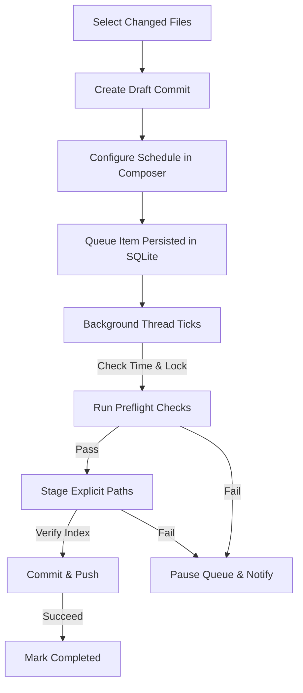

<p align="center">
  
</p>

# GitOutbox

> **Prepare work now. Ship it on your schedule.**

[](https://github.com/i-ayushsingh/gitoutbox)
[](https://github.com/i-ayushsingh/gitoutbox)
[](https://github.com/i-ayushsingh/gitoutbox)
[](https://github.com/i-ayushsingh/gitoutbox)
[](https://github.com/i-ayushsingh/gitoutbox)
[](LICENSE)
[](CHANGELOG.md)
[](https://github.com/i-ayushsingh/gitoutbox)

GitOutbox is a local-first, Windows-first desktop Git scheduling utility. It allows developers to organize changed files into draft commits, compose messages (manually or via variables-based templates), and schedule them to be automatically committed and pushed in the background.

---

## 1. What is GitOutbox?

GitOutbox acts as an outgoing staging queue (an "outbox") for your Git commits. 

Instead of committing your changes immediately, you group files into drafts, assign schedules, and let a lightweight tray-bound background worker manage staging and delivery automatically.

---

## 2. Why GitOutbox?

* **Steady Commit Flows**: Maintain a manageable, spaced-out delivery history rather than pushing huge, single-burst updates.
* **Workspace Independence**: Commit changes in the background without manually context-switching, checking out branches, or stashing active code.
* **Automated Safety**: Protect your repository from incorrect staging, accidental branch crossovers, or dirty merges.

---

## 3. Features

* **Draft Commits Queue**: Group specific changed files, select their target branch, and write or select message templates.
* **System Tray Worker**: Hides to the system tray on window close, executing due items in the background.
* **Four Spacing Distributions**: Distribute commits exactly on time, at fixed intervals, within daily active windows, or allocated across multiple days.
* **Seed-based Spacing**: Generate variable, natural-looking intervals between commits using a deterministic seeded PRNG.
* **Commit Templates**: Seeded templates that automatically resolve file and repository variables (`{stem}`, `{directory}`, etc.) independently per-file.
* **Durable SQLite Database**: Persists all states, schedules, templates, and history logs in a local SQLite database (no in-memory loss).
* **Missed-Schedule Recovery**: Handle execution for items missed while your PC was shut down or asleep (Run immediately, Skip, Ask, or Redistribute).
* **Full Local Activity Audit**: Audit staged status, validation outcomes, commit hashes, and push events inside a local activity log.

---

## 4. How GitOutbox Works



* **Create**: Select unstaged files in a repository, choose target execution mode, and write your commit message.
* **Composer**: Choose your scheduling mode (Exact, Interval, Window, or Multi-day) and distribution (Even or Variable).
* **Worker**: A background Rust thread checks the database every 5 seconds, locking target repositories to prevent concurrent file conflicts.
* **Verify**: Runs safety tests, stages files, double-checks the index, and delivers the commit on schedule.

---

## 5. Git Safety

GitOutbox operates under a strict, non-destructive safety contract:
* **No Wildcard Staging**: Stages files strictly by their explicit relative paths. It never runs broad directory adds like `git add .`.
* **Double-Verification Gate**: Inspects the Git index after staging. If the index contains any files not explicitly assigned to the draft, the transaction rolls back.
* **Fingerprint Safeguard**: Calculates SHA-256 content hashes of files at scheduling time. If the files are edited in your workspace before execution, the item pauses to prevent committing stale or broken code.
* **Pre-staged Protection**: If you already have changes staged in the repository, GitOutbox blocks execution to avoid absorbing your active work.
* **No Workspace Mutations**: Will never auto-checkout, stash, reset, or force-push.
* **Conflict Isolation**: Blocks execution if a merge, rebase, cherry-pick, revert, or bisect is in progress on the repository.
* **Fail Closed**: Any preflight check or staging verification failure transitions the item to `Paused` (marked `Needs Review`) and triggers a notification.

---

## 6. Screenshots

* **Main Window & Changes Staging**
  
* **Schedule Composer Dialog**
  
* **Commit Templates Editor**
  
* **Durable Activity Log**
  
* **Settings & Recovery Policies**
  
* **System Tray Context Menu**
  

---

## 7. Installation

To install GitOutbox on Windows:
1. Download the latest installer (`.msi` or `.exe` setup) from the [Releases](https://github.com/i-ayushsingh/gitoutbox/releases) page.
2. Run the setup wizard to install GitOutbox to your system.
3. Launch the application from your desktop or Start Menu.

---

## 8. Building from Source

To compile and package GitOutbox locally:

### Prerequisites
* **Node.js** (v20+ or v24+)
* **Rust & Cargo** (v1.75+ or v1.96+)
* **C++ Build Tools** (MSVC compiler workload)
* **WiX Toolset** (Required for MSI installer generation)

### Build Steps
1. Install Node dependencies:
   ```bash
   npm install
   ```
2. Start the Tauri development hot-reload loop:
   ```bash
   npm run dev
   ```
3. Compile production packages:
   ```bash
   npx tauri build
   ```
   *Generated installers (.msi and .exe setup) will be outputted to `src-tauri/target/release/bundle/`.*

---

## 9. Running Tests

* **Rust tests** (includes core logic and temporary integration mock repositories):
  ```bash
  cargo test --all
  ```
* **Frontend tests** (includes React mounting lifecycle, template expansion, and selection checks):
  ```bash
  npm test
  ```

---

## 10. Architecture

GitOutbox is separated into three components:
* **Frontend (React)**: An interactive presentation layer built with TypeScript and Tailwind CSS v4. Communicates with Rust using Tauri IPC invoke commands.
* **Backend Crate (`gitoutbox-core`)**: A pure-Rust library with no native system dependencies. Implements status parsing, template expansion, and scheduling mathematics.
* **App Wrapper (`src-tauri`)**: Handles OS window states, system tray menus, desktop notifications, SQLite migrations, and background loops.

For details, refer to the [Architecture Guide](docs/architecture.md).

---

## 11. Roadmap

* **Near-Term (v0.2.0)**: Enhanced tray worker visual status, post-commit hook bypass toggles, and installer size optimization.
* **Mid-Term (v0.3.0)**: Pre-execution shell script check gates, multi-branch target queues, and visual git diff split screens.
* **Long-Term (v0.4.0+)**: Multi-platform releases (macOS and Linux), scheduled background pulls, and a companion CLI.

For details, refer to the [Roadmap Guide](ROADMAP.md).

---

## 12. FAQ

### Does GitOutbox store my credentials or passwords?
No. GitOutbox uses your local Git CLI configurations and existing system SSH/HTTPS credentials helpers. It never prompts for, stores, or transmits passwords or private keys.

### What happens if I am offline when a scheduled push runs?
The local commit is created successfully. The push failure is captured, and the item's status transitions to `PushPending`. It will run up to 3 push-only retries using exponential backoff before pausing.

### Where is the SQLite database file stored?
On Windows, the database file `gitoutbox.db` is located under:
`%APPDATA%\app.gitoutbox.desktop\gitoutbox.db`

For details, refer to the [Frequently Asked Questions Guide](docs/faq.md).

---

## 13. Contributing

Contributions are welcome! Please review the coding conventions, safety invariants, and PR guidelines in the [Contributing Guide](CONTRIBUTING.md) before submitting code.

---

## 14. License

This project is licensed under the MIT License. See [LICENSE](LICENSE) for details.
