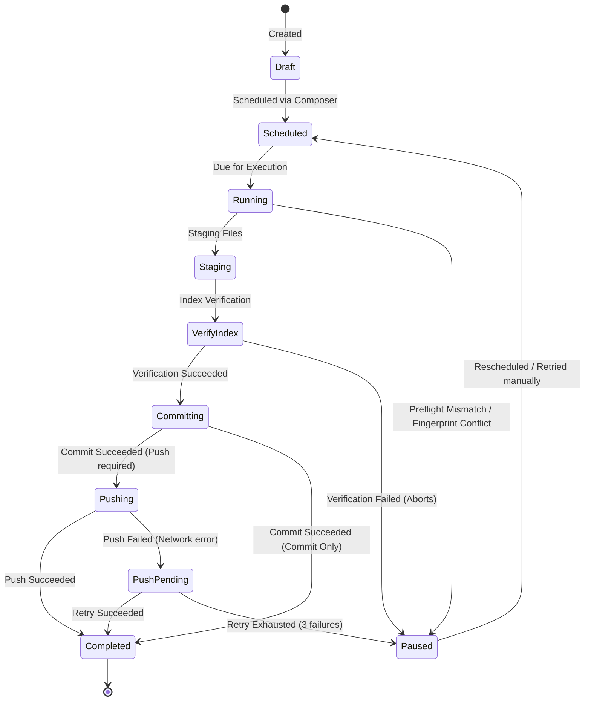

# Background Execution Engine

The background execution engine manages the automated lifecycle of staging, committing, and pushing scheduled drafts.

---

## 1. Background Worker Loop

The executor loop is initialized when Tauri boots. It runs as a detached asynchronous task in Rust:
* **Tick Interval**: Every 5 seconds, the worker queries the SQLite database for any items in the `Scheduled` state whose `scheduled_time` is less than or equal to the current time.
* **Concurrency Locking**: To prevent conflicts in repositories (e.g. concurrent operations on the same working directory), the worker utilizes a global `ExecutionLocks` registry. It locks the repository ID during execution so that other background tasks or manual IPC commands for the same repository must wait.

---

## 2. Queue Item State Machine

Items transition through several distinct states durably recorded in SQLite:

* **Draft**: Created in the workspace. Staged files are assigned but not committed.
* **Scheduled**: Timestamps assigned; waiting for scheduled execution time.
* **Running**: Active execution phase.
* **PushPending**: Commit created successfully, but the push failed (e.g., offline). The item will attempt push-only retries.
* **Completed**: Successfully committed (and pushed, if configured).
* **Paused**: Execution halted due to preflight mismatch, fingerprint changes, or maximum retries exhausted. Requires developer review.

---

## 3. Preflight Checks

Before staging or committing, the executor runs several safety assertions:
1. **Repository Availability**: Verifies the repository path exists and is a valid Git directory.
2. **Current Branch Verification**: Checks that the active checkout branch matches the target branch of the scheduled item. If they differ, it pauses (it will never run checkouts automatically).
3. **Fingerprint Validation**: Compares the current workspace file content hashes against the hashes saved at scheduling time. Any mismatch causes the execution to pause to prevent committing unintended edits.
4. **Operation-in-Progress Detection**: Confirms there are no active merges, rebases, cherry-picks, reverts, or bisects in progress.
5. **Pre-staged Stash Protection**: Confirms the staging area (index) is clean. If files are already staged, it pauses to avoid absorbing unrelated work.

---

## 4. Staging & Index Verification

Once preflight checks pass:
1. The executor runs `git add` strictly for the explicit file paths assigned to the item.
2. It runs `git status --porcelain=v2` and parses the index state.
3. It asserts that the files staged in the index match the expected files exactly.
4. If there is a mismatch (e.g. Git staged additional files due to system behavior), the staging is rolled back and the execution is aborted.

---

## 5. Retry and Backoff Algorithm

If a Git operation fails (usually pushing due to network connectivity):
* The item transitions to `PushPending`.
* The engine attempts up to **3 retries**.
* Between retries, it waits using an exponential backoff timer:
  $$\text{Wait Time} = 2^{\text{Retry Count}} \times 5 \text{ seconds}$$
* If all 3 retries fail, execution halts, the item transitions to `Paused` (marked as `Needs Review`), and a desktop notification is sent to the developer.
